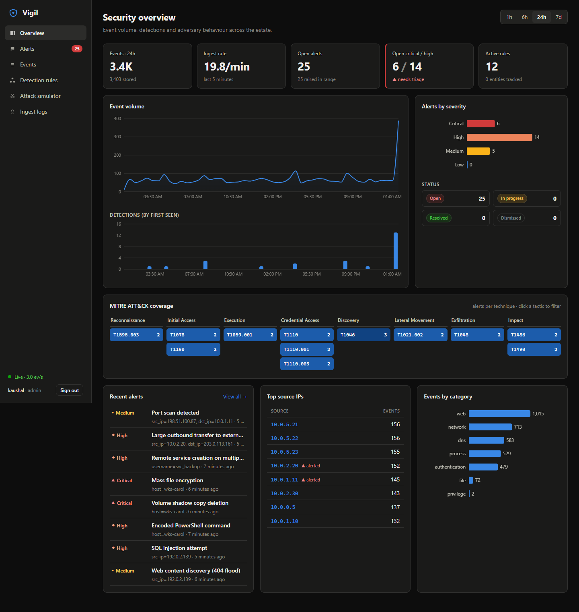
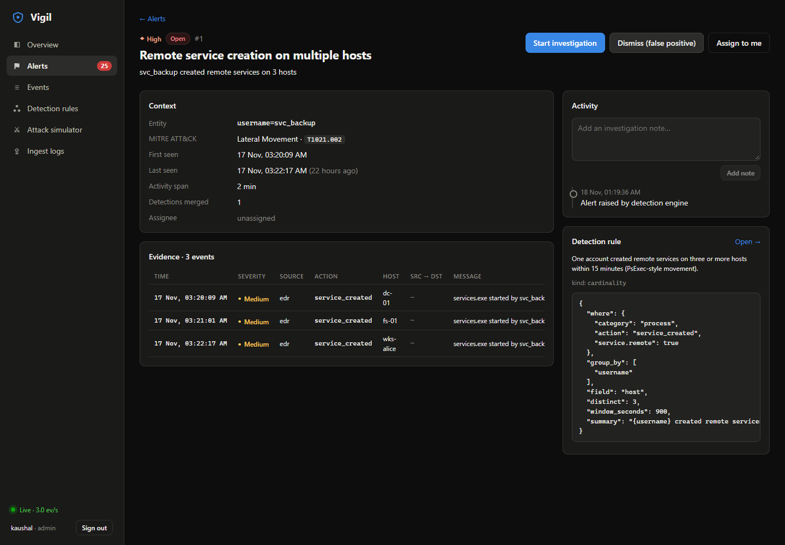
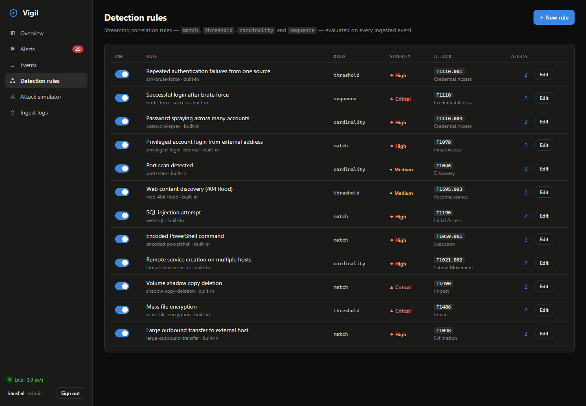
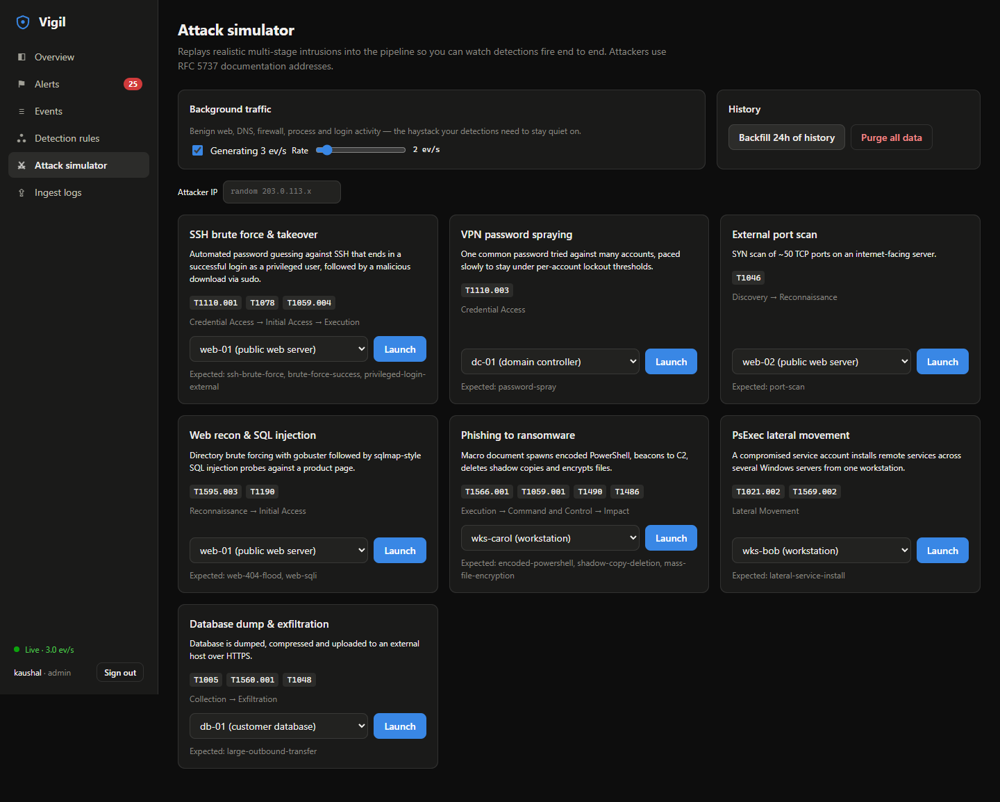

# Vigil — a lightweight SIEM

Vigil is a self-hosted Security Information & Event Management platform. It ingests logs from servers, firewalls, web servers and endpoints, normalises them into a common event schema, correlates them in real time with a streaming detection engine, and gives analysts a dashboard to triage the resulting alerts — all mapped to MITRE ATT&CK.

It ships with an **attack simulator** that replays realistic multi-stage intrusions (SSH brute force, password spraying, ransomware, PsExec lateral movement, data exfiltration …) so every detection can be watched firing end to end.



## Features

- **Log ingestion & parsing** — syslog / `auth.log` (sshd, sudo), UFW / iptables kernel logs, nginx & Apache access logs, `key=value` and JSON lines. Unknown formats are kept as raw events, never dropped. Ships with a zero-dependency [log shipper](tools/ship_logs.py) that tails files.
- **Streaming correlation engine** with four rule kinds, evaluated on every event using *event time* sliding windows (so replayed or back-filled logs still correlate correctly):

  | Kind | Fires when… | Example |
  |---|---|---|
  | `match` | a single event matches | shadow-copy deletion, SQL injection payload |
  | `threshold` | *N* matching events per entity within a window | 6 failed logins from one IP in 2 min |
  | `cardinality` | a field takes *N* distinct values per entity | one IP probing 15 ports; one user installing services on 3 hosts |
  | `sequence` | ordered steps complete within a window | 5 failures **then** a successful login |

- **Rule language** — declarative conditions with `eq / in / contains / regex / gt / cidr / not_cidr …`, `any:` blocks for OR, dotted paths into nested fields, and templated summaries. 12 built-in rules, all mapped to ATT&CK techniques.
- **Rule backtesting** — replay the last 24 h of stored events through a draft rule before saving it.
- **Alert de-duplication** — repeat detections for the same rule + entity fold into one open alert (hit counter + merged evidence) instead of flooding the queue.
- **Triage workflow** — open → in progress → resolved / dismissed, assignment, investigation notes with an automatic audit trail, bulk actions.
- **Live updates** over WebSockets: event rate, new-alert toasts, auto-refreshing queues.
- **Dashboard** — event volume, detections over time, severity breakdown, ATT&CK coverage matrix, top talkers; dark and light themes; works on mobile.
- **Auth** — scrypt password hashing, JWT sessions, admin / analyst roles (first account becomes admin), separate static token for log shippers.

| Alert investigation | Detection rules | Attack simulator |
|---|---|---|
|  |  |  |

## Architecture

```
 log files ─► ship_logs.py ─┐
 syslog / JSON / API ───────┼─► FastAPI ─► parsers ─► normaliser ─► Event store (Postgres / SQLite)
 attack simulator ──────────┘                              │
                                                            ▼
                                          Detection engine (in-memory sliding windows)
                                                            │ detections
                                                            ▼
                                          Alert de-dup / upsert ─► Alert store
                                                            │
                                                  WebSocket broadcaster ─► React dashboard
```

- **Backend:** Python 3.11+, FastAPI, SQLAlchemy 2, Pydantic 2, PyJWT
- **Frontend:** React 19, TypeScript, Vite, Recharts, React Router
- **Storage:** PostgreSQL 16 (Docker) or SQLite (local dev)
- **Deploy:** Docker Compose (Postgres + API + nginx serving the SPA and proxying API/WebSocket)

Key design decisions:

- **Event-time windows.** Correlation state is keyed by `(rule, entity)` and evicted using the events' own timestamps, so a batch of last night's logs produces the same alerts it would have live.
- **Serialized ingest.** Each batch is sorted by timestamp and evaluated under a lock, which keeps sequence rules ordered and makes alert de-duplication race-free.
- **Backfill isolation.** Historical replays run through a throw-away engine instance so they never disturb live windows.
- **No false positives on noise.** The test-suite pushes 5,000 benign events through every rule and asserts zero detections, and runs every attack scenario with several random seeds, asserting each fires the rules it was designed to trip.

## Quick start (Docker)

```bash
cp .env.example .env        # then set VIGIL_JWT_SECRET and VIGIL_INGEST_TOKEN
docker compose up -d --build
```

Open <http://localhost:8080>, create the first (admin) account, and you'll land on a dashboard pre-seeded with 24 hours of synthetic history. Head to **Attack simulator** and launch a scenario to watch alerts arrive live.

## Local development

```bash
# backend  (http://localhost:8000, API docs at /docs)
cd backend
python -m venv .venv && source .venv/bin/activate   # Windows: .venv\Scripts\activate
pip install -r requirements-dev.txt
VIGIL_DEMO_BACKFILL_HOURS=24 uvicorn app.main:app --reload

# frontend (http://localhost:5173, proxies /api to :8000)
cd frontend
npm install
npm run dev

# tests
cd backend && python -m pytest
```

## Sending logs

```bash
# raw lines (any supported format)
curl -X POST http://localhost:8080/api/events/raw \
  -H "X-Ingest-Token: $VIGIL_INGEST_TOKEN" -H "Content-Type: application/json" \
  -d '{"text": "Nov 18 10:15:01 web-01 sshd[123]: Failed password for root from 198.51.100.7 port 52814 ssh2"}'

# structured JSON (single object or array; unknown keys are kept under `extra`)
curl -X POST http://localhost:8080/api/events \
  -H "X-Ingest-Token: $VIGIL_INGEST_TOKEN" -H "Content-Type: application/json" \
  -d '[{"category":"network","action":"connection_allowed","src_ip":"10.0.2.20","dst_ip":"203.0.113.9","bytes_out":90000000}]'

# tail a file
python tools/ship_logs.py /var/log/auth.log --url http://localhost:8080 --follow
```

## Writing a rule

```json
{
  "where": { "category": "dns", "action": "dns_query" },
  "group_by": ["host"],
  "field": "dns.query",
  "distinct": 50,
  "window_seconds": 60,
  "summary": "{host} resolved {count} distinct domains in {seconds}s"
}
```

Create it from the **Detection rules** page (kind `cardinality`), hit *Backtest*, then save — it is live immediately.

## Configuration

| Variable | Default | Purpose |
|---|---|---|
| `VIGIL_DATABASE_URL` | `sqlite:///./vigil.db` | SQLAlchemy URL |
| `VIGIL_JWT_SECRET` | random per start | JWT signing key — **set this** in production |
| `VIGIL_JWT_TTL_MINUTES` | `720` | session length |
| `VIGIL_INGEST_TOKEN` | — | enables `X-Ingest-Token` auth for shippers |
| `VIGIL_ALERT_DEDUP_MINUTES` | `15` | how long an open alert absorbs repeat detections |
| `VIGIL_ALLOW_REGISTRATION` | `true` | allow self-service analyst sign-up |
| `VIGIL_DEMO_BACKFILL_HOURS` | `0` | seed synthetic history on first start |
| `VIGIL_NOISE_EPS` | `0` | benign background events/sec on start |

## Limitations & roadmap

- Correlation state lives in one process, so the API runs as a single worker. Scaling out would mean moving windows to Redis or partitioning the event stream by entity.
- Events are stored in a relational database; at real SIEM volumes they would belong in a columnar or search store (ClickHouse, OpenSearch).
- Planned: Sigma rule import, retention policies, GeoIP / threat-intel enrichment, notification webhooks (Slack, email).

## Acknowledgements

The idea for this project came from the project list in [CarterPerez-dev/Cybersecurity-Projects](https://github.com/CarterPerez-dev/Cybersecurity-Projects). Vigil is an independent implementation with its own design and code.

## License

[MIT](LICENSE)
